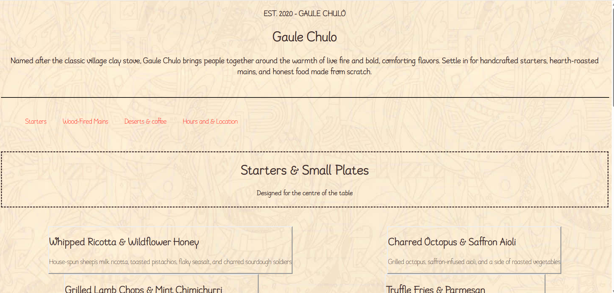

# cafe
It's a prototype for the website of a cafe in my city.

Tools used to make this:
HTML CSS

AI USAGE:
Helped in finding the items for the menu and the description for the items, took a littl help while making the "reserve a table" button functionable (for checking the input types in the register file),and just a little debugging.

USE CASE:
Theres no particular use, i made this to be familiar with html and css so that i would be able to create a fully functional attractive website for cafes in my town.

SCREENSHOT:

